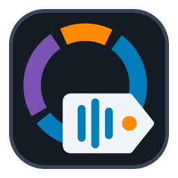
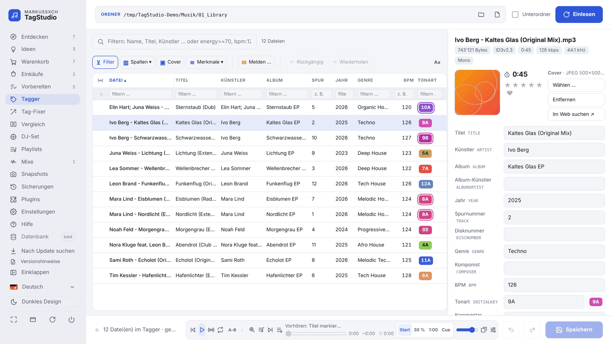
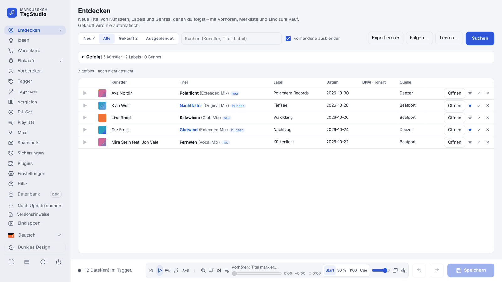
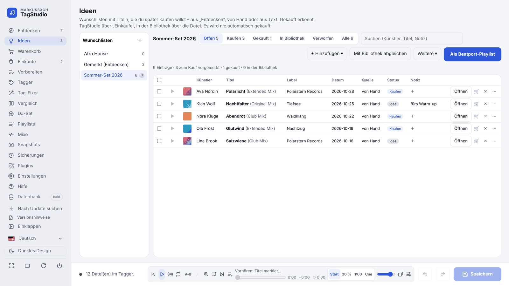
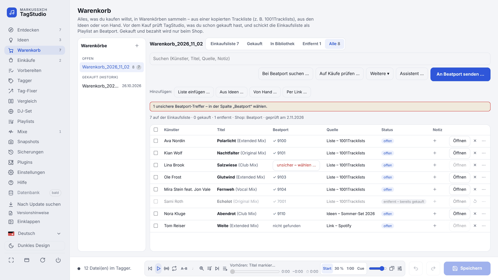
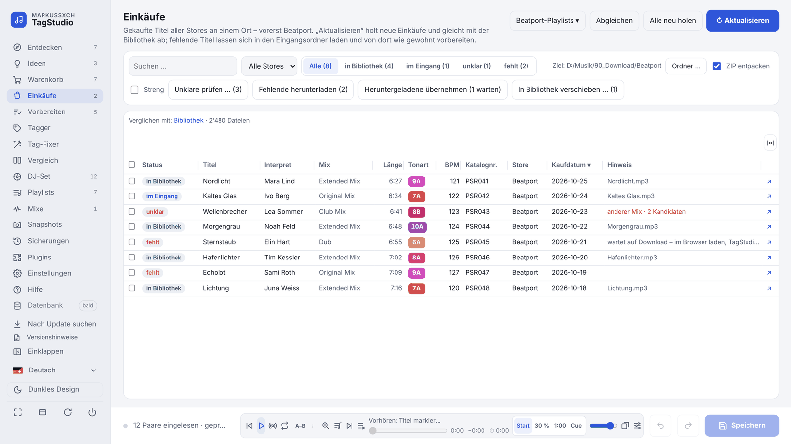
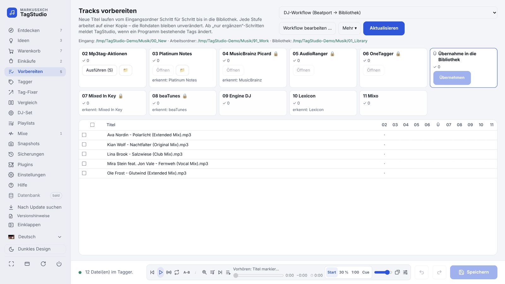
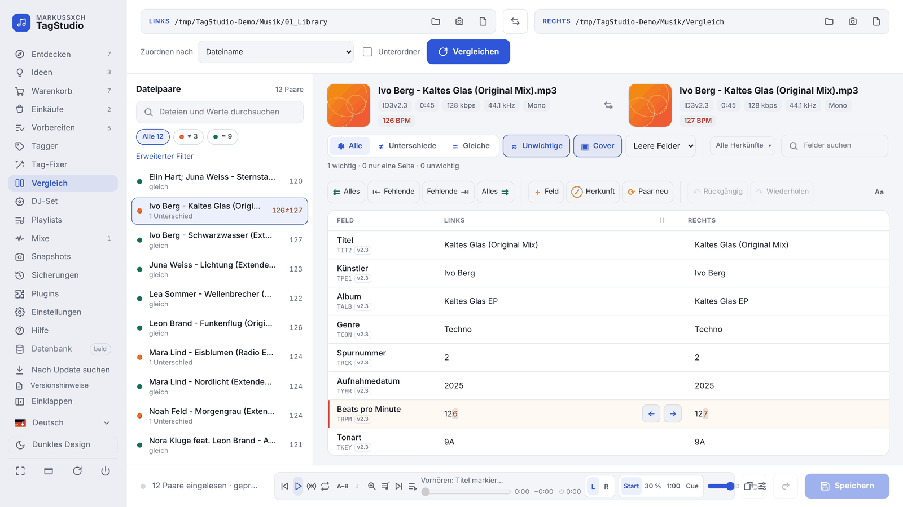
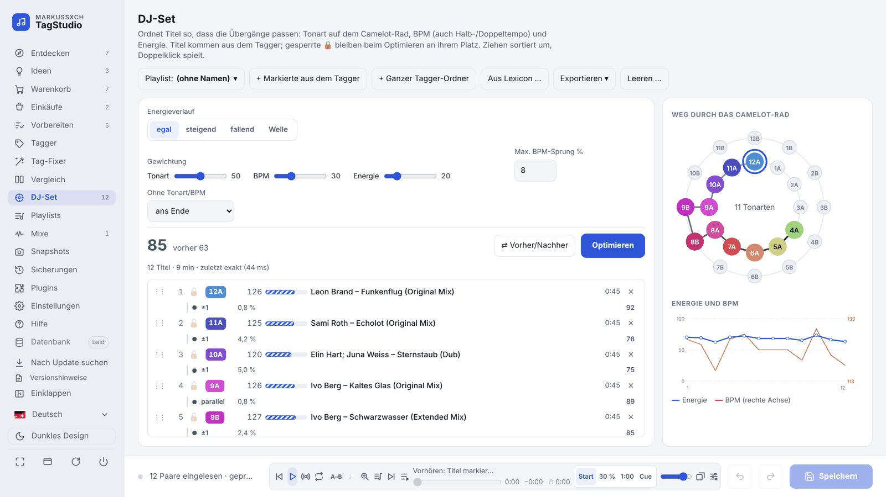
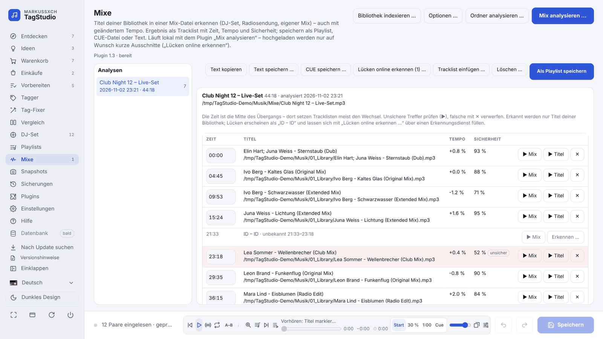

  

<h1 align="center">MarKusSXCH TagStudio</h1>

  <b>The toolbox for DJs' MP3 libraries</b> 
  Discover, shop, tag, compare and plan sets – for Windows and macOS.

  
  
  
  

  
  
  

  <a href="docs/HANDBUCH.en.md">Manual</a> ·
  <a href="CHANGELOG.md">Changes</a> ·
  <a href="PLUGINS.en.md">Plugins</a> ·
  <a href="https://markuskeller8200.github.io/markussxch-tagstudio/">Website</a> ·
  <a href="https://markuskeller8200.github.io/markussxch-tagstudio/statistik.html">Download statistics</a> ·
  <a href="https://github.com/MarkusKeller8200/markussxch-tagstudio/issues">Bugs &amp; ideas</a> ·
  <a href="README.md">Deutsch</a>

<picture>
  <source media="(prefers-color-scheme: dark)" srcset="docs/screenshots/tagger-dark.png">
  
</picture>

The pictures show the German interface; TagStudio also speaks English and Swiss German.

## What TagStudio does

From find to DJ set: **Discover → Ideas → Cart → Purchases → Prepare → Tag → DJ set → Mixes.**

| | | |
|---|---|---|
| 🔎 **Discover & ideas** New releases from followed artists and labels (Beatport, Spotify …), collect ideas in wish lists. | 🛒 **Cart & purchases** Collect tracks to buy (e.g. from 1001Tracklists or MixID), recognise ones already bought, send the shopping list to Beatport; match purchases with the library, download missing ones. | 🏷️ **Tagger** Edit many files at once, covers, tags from the file name, renaming, search & replace, export to Excel/CSV. |
| ⚖️ **Comparison** Two folders or files field by field – marked character by character, copy values with an arrow. | 🧹 **Tag fixer** Unify multiple values (`;` `/` `feat.` …), Smart Fix recipes, exceptions per field. | 🎛️ **DJ set** Optimise the order by key (Camelot), BPM and energy – export as M3U8, Rekordbox XML, CSV. |
| 🎚️ **Mixes** Recognise tracks of your library in DJ mixes, fill gaps from tracklists, link mix and tracks. | 📂 **Playlists** Collect tracks, sort them into folders, as M3U8 for Engine DJ, VirtualDJ & co. | 🎧 **Preview player** Waveform, cue points (Serato, Mixed In Key), crossfading with tempo matching, ratings. |
| ☁️ **Cloud: mirror & backup** Music as a one-way copy in OneDrive, Google Drive or Dropbox; back up the program data. | 🛡️ **Safe saving** Backup before every save, undo across all files, snapshots and change journal. | 🧩 **Plugins** Stems, Beatport, Spotify, Discogs, MusicBrainz, SonoVault, Lexicon … – by category, updatable one by one. |

Plus: Camelot wheel and key notations, audio features (energy, danceability …) as columns, origin of tags,
settings in one place, update notice, German, English and Swiss German.
Everything in detail in the **[manual](docs/HANDBUCH.en.md)**.

## New in recent versions

- **4.15 – Cart:** paste a tracklist (1001Tracklists, MixID …) or take tracks from Ideas, wizard with preview,
  recognise tracks already bought, send the shopping list as a Beatport playlist, history “Open/Bought”.
- **4.14 – Cloud & Spotify:** mirror of the library and backup of the program data in the cloud, Spotify as a source
  for Discover and Ideas, update notification, SHA-256 checksums of the installers.
- **4.13 – Ideas & mixes:** wish lists on the “Ideas” page, recognise tracks in DJ mixes (“Analyse mix”, MixID
  tracklists), macOS app signed and notarised by Apple.

All changes: [CHANGELOG](CHANGELOG.md) (German).

## Pictures

<table>
  <tr>
    <td width="50%"><picture><source media="(prefers-color-scheme: dark)" srcset="docs/screenshots/discover-dark.png"></picture> <b>Discover</b> – new from followed artists and labels</td>
    <td width="50%"><picture><source media="(prefers-color-scheme: dark)" srcset="docs/screenshots/ideas-dark.png"></picture> <b>Ideas</b> – wish lists with status “Buy”</td>
  </tr>
  <tr>
    <td width="50%"><picture><source media="(prefers-color-scheme: dark)" srcset="docs/screenshots/carts-dark.png"></picture> <b>Cart</b> – recognise tracks already bought, send to Beatport</td>
    <td width="50%"><picture><source media="(prefers-color-scheme: dark)" srcset="docs/screenshots/purchases-dark.png"></picture> <b>Purchases</b> – bought, in inbox, in library, missing</td>
  </tr>
  <tr>
    <td width="50%"><picture><source media="(prefers-color-scheme: dark)" srcset="docs/screenshots/prep-dark.png"></picture> <b>Prepare</b> – new tracks step by step</td>
    <td width="50%"><picture><source media="(prefers-color-scheme: dark)" srcset="docs/screenshots/compare-dark.png"></picture> <b>Comparison</b> – differences per field, copy with an arrow</td>
  </tr>
  <tr>
    <td width="50%"><picture><source media="(prefers-color-scheme: dark)" srcset="docs/screenshots/djset-dark.png"></picture> <b>DJ set</b> – path through the Camelot wheel, energy and BPM</td>
    <td width="50%"><picture><source media="(prefers-color-scheme: dark)" srcset="docs/screenshots/mixes-dark.png"></picture> <b>Mixes</b> – recognise tracks in DJ mixes</td>
  </tr>
</table>

Pictures with made-up example tracks, created with <code>tools/screenshots.py</code>.

## Installation

**With the installer (recommended, no Python needed):** on
[Latest version](https://github.com/MarkusKeller8200/markussxch-tagstudio/releases/latest) download the file for your
system from the “Download” box at the top.

- **Windows:** run `TagStudio-<version>-Windows-Setup.exe` – no administrator rights needed. The installer is not
  signed: at “Windows protected your PC” choose **More info → Run anyway**.
- **macOS (Apple silicon):** open `TagStudio-<version>-macOS-Apple-Chip.dmg`, drag **TagStudio** to **Applications** –
  signed and notarised by Apple (from 4.13.0).

**From source:** Python 3.12 or newer, then
`git clone https://github.com/MarkusKeller8200/markussxch-tagstudio.git` and `start_windows.bat` or
`start_mac.command`. Details, updates and all options: [Manual › Installation](docs/HANDBUCH.en.md#installation).

> Up to version 2.8 the program was called “MP3 Tag Compare”. Settings and backups from that time are taken over
> automatically.

## Contributing and contact

- **Report bugs, suggest ideas:** [Issues](https://github.com/MarkusKeller8200/markussxch-tagstudio/issues) – or
  directly in TagStudio via “Report …”.
- **Contributing:** [CONTRIBUTING.md](CONTRIBUTING.md) · **Code of conduct:** [CODE_OF_CONDUCT.md](CODE_OF_CONDUCT.md)
- **Security:** [SECURITY.md](SECURITY.md) · **Third-party components:** in TagStudio under Help › Licences
- **Licence:** [GNU GPL v3](LICENSE) – free to use, changes stay open.
