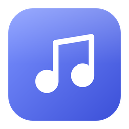
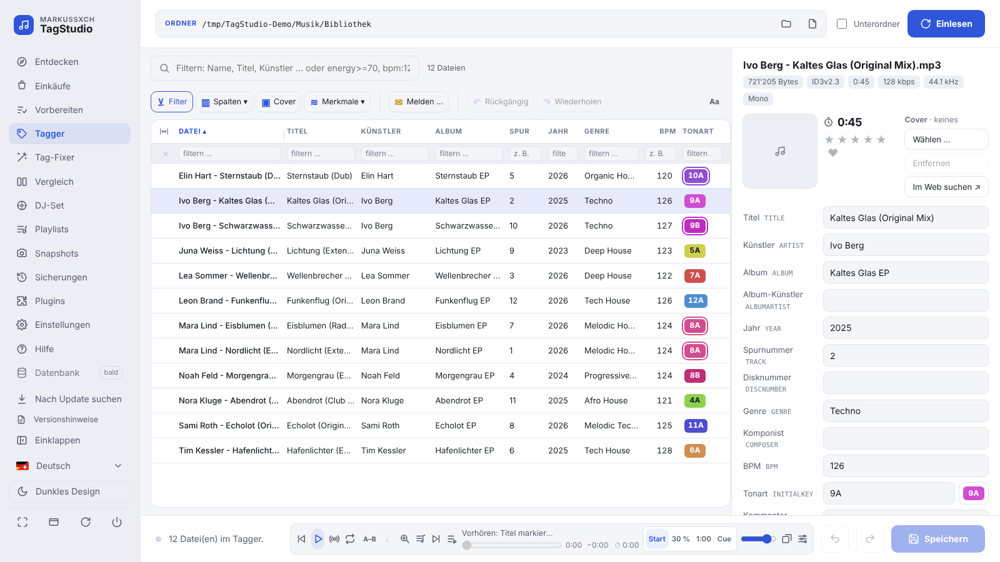
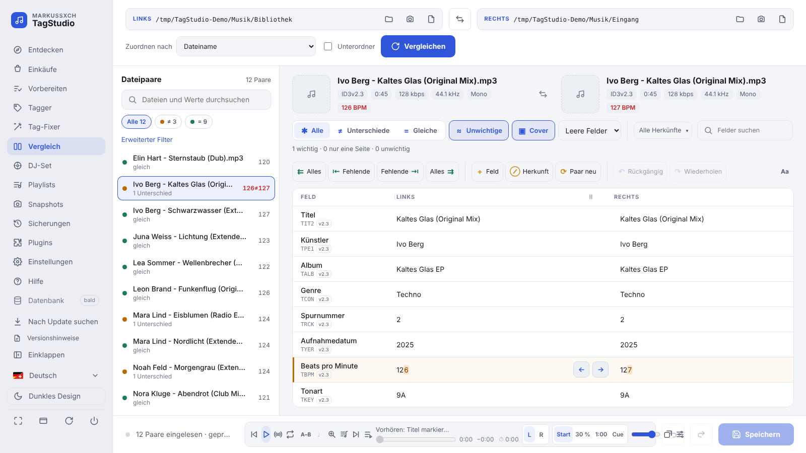
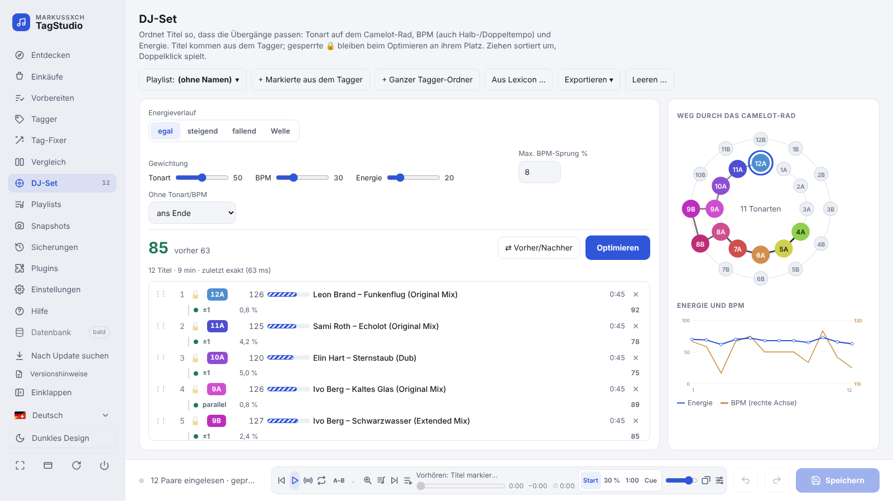
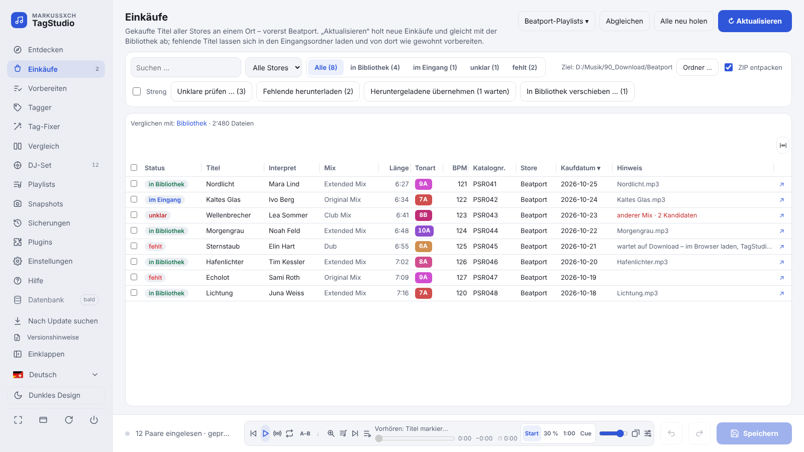
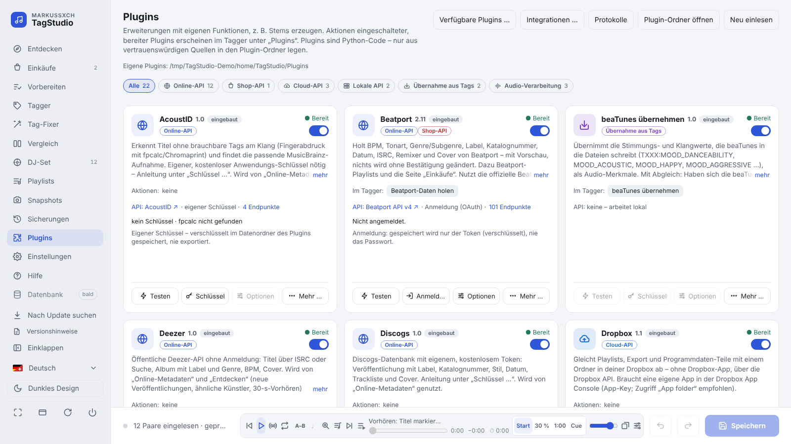

  

<h1 align="center">MarKusSXCH TagStudio</h1>

  <b>Der Werkzeugkasten für die MP3-Bibliothek von DJs</b> 
  Taggen, vergleichen, aufräumen, Einkäufe abgleichen und Sets planen – für Windows und macOS.

  
  
  
  

  
  
  

  <a href="docs/HANDBUCH.md">Handbuch</a> ·
  <a href="CHANGELOG.md">Änderungen</a> ·
  <a href="PLUGINS.md">Plugins</a> ·
  <a href="https://markuskeller8200.github.io/markussxch-tagstudio/">Webseite</a> ·
  <a href="https://markuskeller8200.github.io/markussxch-tagstudio/statistik.html">Download-Statistik</a> ·
  <a href="https://github.com/MarkusKeller8200/markussxch-tagstudio/issues">Fehler &amp; Ideen</a> ·
  <a href="README.en.md">English</a>

<picture>
  <source media="(prefers-color-scheme: dark)" srcset="docs/screenshots/tagger-dark.png">
  
</picture>

## Was TagStudio kann

| | | |
|---|---|---|
| 🏷️ **Tagger** Viele Dateien gemeinsam bearbeiten, Cover, Tags aus dem Dateinamen, Umbenennen, Suchen & Ersetzen, Export nach Excel/CSV. | ⚖️ **Vergleich** Zwei Ordner oder Dateien Feld für Feld – zeichengenau markiert, Werte per Pfeil übernehmen. | 🧹 **Tag-Fixer** Mehrfachwerte (`;` `/` `feat.` …) vereinheitlichen, Smart-Fix-Rezepte, Ausnahmen je Feld. |
| 🛒 **Einkäufe** Gekaufte Titel (Beatport) mit der Bibliothek abgleichen, fehlende laden, Playlists in Beatport anlegen. | 🎛️ **DJ-Set** Reihenfolge nach Tonart (Camelot), BPM und Energie optimieren – Export als M3U8, Rekordbox-XML, CSV. | 📂 **Playlists** Titel sammeln, in Ordnern ordnen, als M3U8 für Engine DJ, VirtualDJ & Co. |
| 🎧 **Vorschau-Player** Wellenform, Cue-Marken (Serato, Mixed In Key), Überblenden mit Tempo-Angleichung, Bewertung. | 🛡️ **Sicher speichern** Sicherung vor jedem Speichern, Rückgängig über alle Dateien, Snapshots und Änderungsjournal. | 🧩 **Plugins** Stems, Beatport, Discogs, MusicBrainz, Lexicon, Cloud-Abgleich (OneDrive, Google Drive, Dropbox) … |

Dazu: Camelot-Rad und Tonart-Schreibweisen, Audio-Merkmale (Energy, Danceability …) als Spalten, Herkunft der Tags,
„Entdecken“ neuer Veröffentlichungen, Einstellungen an einem Ort, Deutsch, Englisch und Zürichdeutsch.
Alles im Detail im **[Handbuch](docs/HANDBUCH.md)**.

## Bilder

<table>
  <tr>
    <td width="50%"><picture><source media="(prefers-color-scheme: dark)" srcset="docs/screenshots/compare-dark.png"></picture> <b>Vergleich</b> – Unterschiede je Feld, per Pfeil übernehmen</td>
    <td width="50%"><picture><source media="(prefers-color-scheme: dark)" srcset="docs/screenshots/djset-dark.png"></picture> <b>DJ-Set</b> – Weg durch das Camelot-Rad, Energie und BPM</td>
  </tr>
  <tr>
    <td width="50%"><picture><source media="(prefers-color-scheme: dark)" srcset="docs/screenshots/purchases-dark.png"></picture> <b>Einkäufe</b> – gekauft, im Eingang, in der Bibliothek, fehlt</td>
    <td width="50%"><picture><source media="(prefers-color-scheme: dark)" srcset="docs/screenshots/plugins-dark.png"></picture> <b>Plugins</b> – nach Kategorie, einzeln aktualisierbar</td>
  </tr>
</table>

Bilder mit erfundenen Beispieltiteln, erstellt mit <code>tools/screenshots.py</code>.

## Installation

**Mit Installer (empfohlen, kein Python nötig):** unter
[Neueste Version](https://github.com/MarkusKeller8200/markussxch-tagstudio/releases/latest) ganz oben im Kasten
„Download“ die Datei für dein System laden.

- **Windows:** `TagStudio-<Version>-Windows-Setup.exe` ausführen – ohne Administratorrechte. Der Installer ist nicht
  signiert: bei „Der Computer wurde durch Windows geschützt“ **Weitere Informationen → Trotzdem ausführen**.
- **macOS (Apple-Chip):** `TagStudio-<Version>-macOS-Apple-Chip.dmg` öffnen, **TagStudio** auf **Programme** ziehen;
  beim ersten Start **Systemeinstellungen → Datenschutz & Sicherheit → „Trotzdem öffnen“**.

**Aus dem Quellcode:** Python 3.12 oder neuer, dann
`git clone https://github.com/MarkusKeller8200/markussxch-tagstudio.git` und `start_windows.bat` bzw.
`start_mac.command`. Details, Updates und alle Optionen: [Handbuch › Installation](docs/HANDBUCH.md#installation).

> Bis Version 2.8 hiess das Programm „MP3 Tag Compare“. Einstellungen und Sicherungen von damals werden automatisch übernommen.

## Mitmachen und Kontakt

- **Fehler melden, Ideen vorschlagen:** [Issues](https://github.com/MarkusKeller8200/markussxch-tagstudio/issues) –
  oder direkt in TagStudio über „Melden …“.
- **Mitmachen:** [CONTRIBUTING.md](CONTRIBUTING.md) · **Verhaltenskodex:** [CODE_OF_CONDUCT.md](CODE_OF_CONDUCT.md)
- **Sicherheit:** [SECURITY.md](SECURITY.md) · **Fremdkomponenten:** in TagStudio unter Hilfe › Lizenzen
- **Lizenz:** [GNU GPL v3](LICENSE) – frei nutzbar, Änderungen bleiben offen.
