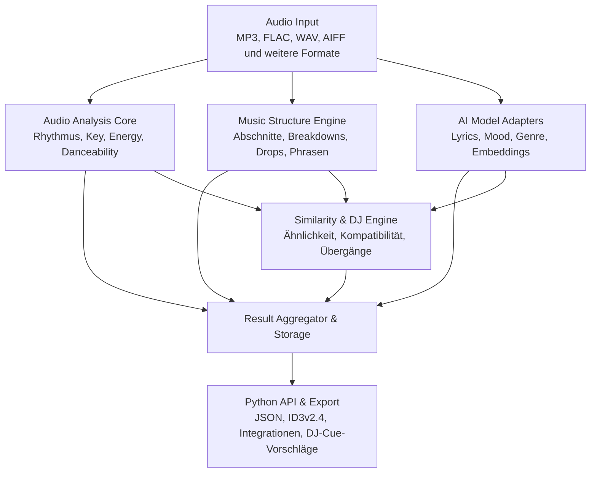

# Konzept: Musik analysieren – MusicAnalyzer

**Stand:** 14. Oktober 2026 · **Konzeptbasis:** Version 0.1 vom 13. Oktober 2026  
**Status:** Geplant / Konzeptgrundlage; technische Auswahl und Implementierungsfreigabe noch offen  
**Quelle:** `2026_10_14_Konzept_ANALYSE_Open_Source_LLMs.pdf` (5 Seiten, vom Nutzer bereitgestellt)

> **Pflege:** Dieses Detailkonzept ist bei Arbeiten an Audioanalyse, MusicAnalyzer, Track-Matching und Übergangsempfehlungen mitzuberücksichtigen und im selben Zug nachzuführen. Es ergänzt das [übergreifende Produkt- und Architekturkonzept](KONZEPT-PRODUKT-ARCHITEKTUR.md); offene Entscheidungen und Evaluationskandidaten sind **keine bereits freigegebenen Implementierungsentscheide**.
>
> **Produktgrenze:** Die Analyse unterstützt TagStudio bei Musikverwaltung, Tagging und DJ-Set-Planung. Sie ist nicht als Bauplan für eine vollständige Live-DJ-Mixing-Software oder DAW zu verstehen.

## 1. Projektidee und Zielsetzung

Ziel ist eine **eigenständige, modulare Open-Source-Python-Library** namens **MusicAnalyzer**, die Musikdateien umfassend analysiert und die Resultate für DJ-Anwendungen, Musikverwaltung und intelligente Track-Empfehlungen bereitstellt.

Dazu werden bestehende Open-Source-Projekte und wissenschaftliche Algorithmen untersucht. Bewährte Verfahren können unter Beachtung ihrer Lizenzbedingungen eigenständig implementiert werden; spezialisierte KI-Modelle werden über **optionale Schnittstellen** eingebunden. Langfristig soll die Library möglichst unabhängig von einzelnen Drittprojekten sein.

### 1.1 Grundprinzipien

- **Local First:** Musikanalyse lokal und nach dem erstmaligen Herunterladen benötigter Modelle auch offline.
- **Plattformübergreifend:** Unterstützung für Windows und macOS.
- **Modulare Architektur:** Analysefunktionen sind separat nutzbar, austauschbar und erweiterbar.
- **CPU und GPU:** CPU als verlässliche Basis; optionale GPU-Beschleunigung, wenn das Modell sie unterstützt.
- **Batch-Verarbeitung:** Tausende Musikdateien effizient verarbeiten; Cache und Wiederaufnahme einplanen.
- **Offene Schnittstellen:** Python-API, JSON-Export und Anbindung an vorhandene Musiksoftware.
- **Nachvollziehbarkeit:** Analysewerte, Berechnungsmethode, Modell-/Algorithmusversion und Unsicherheiten dokumentieren.

## 2. Vorgesehener Funktionsumfang

| Modul | Vorgesehene Funktionen | Priorität |
|---|---|---|
| **Rhythm Engine** | BPM, Beats, Downbeats, Beatgrid, Groove | Hoch |
| **Harmonic Engine** | Tonart, Camelot-Key, harmonische Merkmale | Hoch |
| **Energy Engine** | Energy auf einer Skala von 0–100, Dynamik, Energy-Verlauf | Hoch |
| **Danceability Engine** | Tanzbarkeit auf einer Skala von 0–100, Rhythmusstabilität | Hoch |
| **Mood Engine** | Stimmung, Happiness, Valence, emotionale Eigenschaften | Mittel |
| **Structure Engine** | Intro, Verse, Chorus, Breakdown, Build-up, Drop, Outro | Hoch |
| **Similarity Engine** | Klangähnlichkeit und musikalische Embeddings | Hoch |
| **DJ Compatibility Engine** | Mix-Kompatibilität sowie harmonische und rhythmische Übergänge | Hoch |
| **Transition Engine** | Geeignete Mix-in-/Mix-out-Punkte und Übergangsvorschläge | Mittel |
| **Lyrics Engine** | Songtexte, Sprache und Wort-Zeitstempel | Mittel |
| **Genre Engine** | Genres, Subgenres und musikalischer Stil | Mittel |

**Abgrenzung:** Die aufgeführten Prioritäten stammen aus der Konzeptbasis. Sie ersetzen keine spätere Roadmap- oder Implementierungsfreigabe.

## 3. Intelligente Track-Erkennung und Empfehlungen

Eine Kernfunktion ist das Erkennen **ähnlicher Tracks** und **musikalisch kompatibler Tracks**. Diese beiden Konzepte sind nicht gleichzusetzen: Ein Track kann ähnlich klingen, ohne für den gewünschten DJ-Set-Verlauf der beste nächste Titel zu sein.

### 3.1 Musikalische Ähnlichkeit – `find_similar_tracks()`

Findet Tracks mit ähnlichem:

- Klangcharakter und Genre,
- Instrumentierung und Stimmung,
- musikalischem Aufbau.

Als Grundlage dienen **Audio-Embeddings** und klassische Audio-Merkmale.

### 3.2 DJ-Kompatibilität – `find_compatible_tracks()`

Bewertet, wie gut sich zwei Tracks in einem DJ-Set kombinieren lassen. Vorgesehene Kriterien:

- BPM-Differenz,
- Camelot-Distanz,
- Energy und Danceability,
- Groove und Stimmung.

### 3.3 Übergangsanalyse – `find_best_transition()`

Sucht geeignete Mix-in- und Mix-out-Punkte. Berücksichtigt werden:

- Beats und musikalische Phrasen,
- Positionen von Drops und Breakdowns,
- zeitabhängige Energy-Verläufe.

### 3.4 Transparente Bewertung

Empfehlungen sollen **nicht nur einen Gesamtscore** zurückgeben, sondern auch die **einzelnen Bewertungsfaktoren**. Unterschiedliche Gewichtungsprofile sollen etwa folgende Ziele unterstützen:

- **Harmonisch:** Besonders kompatible Tonarten und Phrasen.
- **Energieorientiert:** Gewünschter Aufbau oder Abbau des Spannungsverlaufs.
- **Stilistisch ähnlich:** Möglichst passender Klangcharakter und Stil.

Die genaue Score-Berechnung, Gewichtung und Kalibrierung ist **noch offen**.

## 4. Musikalische Strukturen, Build-ups und Drops erkennen

Die **Structure Engine** soll musikalische Abschnitte automatisch erkennen, klassifizieren und zeitlich markieren.

Ein besonderer Schwerpunkt ist elektronische Musik, namentlich **House, Progressive House, Melodic House, Tech House und Techno**.

### 4.1 Erkennungsmerkmale für Drops

Die Konzeptbasis sieht eine Kombination unter anderem folgender Signalmerkmale vor:

- RMS und Bassenergie,
- Onset-Dichte und Spectral Flux,
- Percussion-Merkmale,
- rhythmische Phrasen,
- vorangehender Spannungsaufbau (Build-up).

### 4.2 Resultate

Jedes erkannte musikalische Ereignis soll nach Möglichkeit folgende Daten besitzen:

| Feld | Bedeutung |
|---|---|
| Zeitstempel | Position des Ereignisses im Track |
| Ereignistyp | Z. B. Build-up, Breakdown oder Drop |
| Intensität | Bewertung der Ausprägung |
| Confidence | Konfidenzwert, **sofern dafür eine Kalibrierung vorliegt** |

Die Strukturinformationen sollen künftig auch **Vorschläge für Hot Cues in DJ-Software** ermöglichen. Erkennung und Cue-Vorschlag sind dabei vom tatsächlichen Schreiben in fremde Bibliotheken zu trennen.

## 5. Technologische Grundlage – Evaluationskandidaten

Die PDF führt folgende Projekte und Technologien als mögliche Grundlagen auf. **Die Nennung ist keine Aussage, dass aktuelle Wartung, Plattformunterstützung, Lizenz- oder Modellkompatibilität bereits bestätigt sind.**

| Technologie / Projekt | Vorgesehene Verwendung |
|---|---|
| NumPy / SciPy | Eigene Signalverarbeitung und mathematische Algorithmen |
| librosa | Referenz für Rhythmus, Chroma, Spektral- und Feature-Analyse |
| Essentia | Vergleichsverfahren, Klassifikatoren und Musik-Embeddings |
| Discogs-EffNet | Musikalische Ähnlichkeit und Stilrepräsentationen |
| LAION-CLAP | Semantische Ähnlichkeit, Stimmung und Beschreibung |
| MERT | Erweiterte musikalische Embeddings |
| faster-whisper / WhisperX | Transkription und Synchronisierung von Lyrics |
| python-audio-separator | Optionale Gesangs- und Instrumententrennung |
| MOSS-Music | Experimentelles Modul für umfassendes Musikverständnis |
| FAISS / hnswlib | Effiziente Ähnlichkeitssuche in grossen Musikbibliotheken |

**Architekturvorgabe aus der Vorlage:** Nicht sämtliche Technologien werden feste Abhängigkeiten. Der **Analysekern muss auch ohne grosse KI-Modelle nutzbar** sein.

### 5.1 Kriterien für die spätere Evaluation

Vor einer verbindlichen Technologieauswahl sind insbesondere zu prüfen:

1. Wartungs- und Entwicklungsstatus des Projekts.
2. Lizenzbedingungen für Quellcode **und** Modellgewichte sowie deren Vereinbarkeit mit der angestrebten Distribution.
3. Python-Kompatibilität und Integrationsaufwand.
4. Lokale Ausführung unter Windows und macOS.
5. CPU-Ausführung und optionale GPU-Beschleunigung auf tatsächlich unterstützter Hardware.
6. Analysequalität und Rechenaufwand bei grösseren Musikbibliotheken.

Diese Punkte sind **Prüfaufträge**, keine vorweggenommenen Testergebnisse.

## 6. Vorgeschlagene Systemarchitektur

Die in der Quelle dargestellte Architektur umfasst vier spezialisierte Verarbeitungsbereiche und eine zentrale Zusammenführung der Ergebnisse:

### 6.1 Aufgaben der Schichten

| Schicht | Aufgabe |
|---|---|
| Audio Input | Musikdateien unterschiedlicher unterstützter Formate bereitstellen |
| Audio Analysis Core | Klassische musikalische und signaltechnische Merkmale berechnen |
| Music Structure Engine | Songabschnitte, musikalische Phrasen und Ereignisse erkennen |
| AI Model Adapters | Optionale spezialisierte Modelle für Lyrics, Stimmung, Genre und Embeddings nutzen |
| Similarity & DJ Engine | Ähnlichkeiten, Track-Kompatibilität und Übergänge bewerten |
| Result Aggregator & Storage | Werte vereinheitlichen, validieren, Konfidenzen verwalten, Ergebnisse cachen und speichern |
| Python API & Export | Resultate für andere Module und Programme bereitstellen |

Die konkrete Implementierung der Module, Prozesse, Caches und Datenbank ist noch nicht beschlossen.

## 7. Entwicklungsphasen

| Phase | Schwerpunkt | Angestrebtes Ergebnis |
|---|---|---|
| **1** | Bestehende Projekte, Algorithmen und Lizenzen analysieren | Technische Grundlagen und Architektur |
| **2** | Audio Core, BPM, Key, Energy und Danceability | Erste funktionsfähige Library |
| **3** | Struktur-, Build-up- und Drop-Erkennung | Zeitbasierte Musikanalyse |
| **4** | Embeddings und Similarity Engine | Automatische Suche ähnlicher Tracks |
| **5** | DJ Compatibility und Transition Engine | Mix-Empfehlungen und Übergangspunkte |
| **6** | Mood, Genre, Lyrics und erweiterte KI | Umfassende semantische Analyse |
| **7** | Benchmarks, Optimierung und Veröffentlichung | Plattformübergreifendes Python-Paket |

Die Phasen geben die Reihenfolge der **Konzeptbasis** wieder. Verbindliche Releases und Meilensteine werden separat geplant.

## 8. Offene Konzeptentscheidungen

Vor einer verbindlichen Umsetzung sind diese Fragen zu klären:

| Thema | Offene Frage |
|---|---|
| **Lizenzmodell** | MIT, Apache-2.0 oder anderes Modell? Sind Drittcode und Modellgewichte damit kompatibel? |
| **Bewertungsskalen** | Wie werden Energy, Danceability und DJ-Kompatibilität konsistent auf 0–100 kalibriert? |
| **Referenzdaten** | Welche Tracks und manuell bewerteten Beispiele dienen zur Qualitätsmessung? |
| **Hardware** | Welche Mindestanforderungen und GPU-Backends werden offiziell unterstützt? |
| **Metadaten** | Welche Analysewerte gehören direkt in Audio-Tags und welche ausschliesslich in externe Speicherung? |
| **Modellstrategie** | Welche Modelle werden mitgeliefert, optional heruntergeladen oder nur über Plugins genutzt? |
| **Produktgrenzen** | Wie bleibt die Library eigenständig und zugleich leicht in TagStudio und andere DJ-Werkzeuge integrierbar? |

**Hinweis zur Lizenzfrage:** Das PDF formuliert ein künftiges Lizenzmodell für die eigenständige Library als offene Frage. Daraus folgt **keine Änderung** an der bestehenden TagStudio-Projektlizenz.

## 9. Projektvision

MusicAnalyzer soll eine **leistungsfähige, lokale und plattformübergreifende Open-Source-Engine** für intelligente Musikanalyse werden.

Im Vordergrund steht nicht allein die Ermittlung klassischer Audio-Metadaten, sondern ein besseres Verständnis des musikalischen Aufbaus und dessen Nutzen für DJ-Workflows. Dazu gehören insbesondere:

- musikalische Struktur und wichtige Ereignisse erkennen,
- zeitabhängige Energy-Verläufe untersuchen,
- ähnliche Tracks intelligent finden,
- für ein DJ-Set passende Tracks und Übergänge empfehlen.

**Leitgedanke der Konzeptbasis:** MusicAnalyzer soll nicht nur beschreiben, *was ein Track ist*, sondern auch erkennen, *wie er aufgebaut ist*, *wie er wirkt* und *zu welchen anderen Tracks er passt*.

## 10. Einordnung in die bestehende TagStudio-Dokumentation

Dieser Abschnitt ordnet die Quelle in die **bereits vorhandene Projektdokumentation** ein und ist keine zusätzliche Aussage aus der PDF:

- [KONZEPT-PRODUKT-ARCHITEKTUR.md](KONZEPT-PRODUKT-ARCHITEKTUR.md): Übergeordnete Produktvision, Leitplanken und offene Architekturentscheide.
- [KONZEPT-DJSET.md](KONZEPT-DJSET.md): Nutzung von Kompatibilitäts- und Übergangswerten in der DJ-Set-Planung.
- [KONZEPT-PLAYER.md](KONZEPT-PLAYER.md): Gezieltes Vorhören der erkannten Songstellen und Übergangsvorschläge.
- [KONZEPT-PLUGINS.md](KONZEPT-PLUGINS.md): Anbindung optionaler Analysemodelle und weiterer Werkzeuge.

Bei späteren Implementierungen sind die bestehenden Schutzregeln für Tags, unbekannte Frames, Backups, Undo und externe DJ-Bibliotheken einzuhalten. **Eine automatisch erkannte Empfehlung darf nicht ohne ausdrückliche Benutzerentscheidung fremde Daten überschreiben.**

## 11. Nächste Schritte für die Konkretisierung

Das Ausgangsdokument beschreibt eine **Konzeptgrundlage**, noch keine vollständige technische Spezifikation. Für eine Implementierung sind anschliessend insbesondere auszuarbeiten:

- messbare Qualitäts- und Abnahmekriterien je Analysemodul,
- Referenz- und Testdatensätze sowie reproduzierbare Benchmarks,
- Schnittstellen und versioniertes Datenmodell für Analyseergebnisse,
- Lizenz- und Plattformprüfung der favorisierten Algorithmen und Modelle,
- Integration der Resultate in TagStudio, ohne bestehende manuelle Korrekturen zu verlieren.

**Dokumentstatus:** Inhaltlich aus dem bereitgestellten PDF als GitHub-Markdown-Detailkonzept übertragen und für die bestehende Dokumentationsstruktur gegliedert. Die erwähnten Technologien, Leistungswerte und offenen Fragen wurden **nicht zusätzlich extern validiert**.