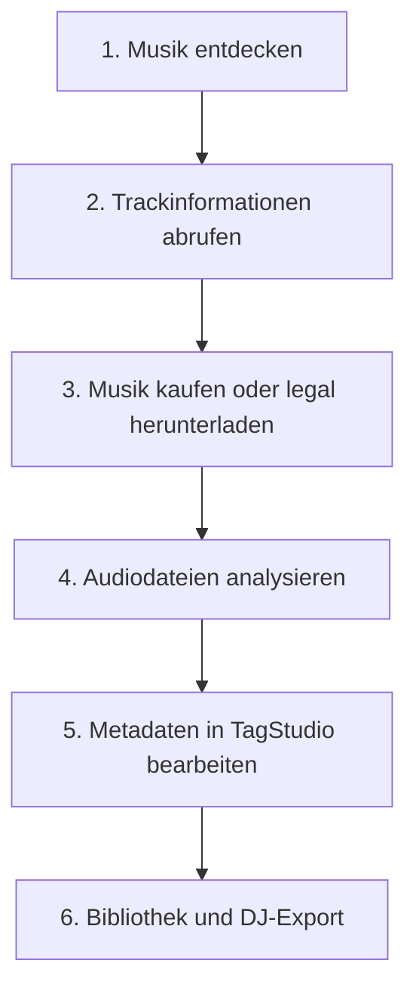

# Konzept: DJ-Musikplattformen – Vergleich, API und Workflow

**Stand:** Oktober 2026  
**Dokumenttyp:** Detailkonzept für TagStudio  
**Status:** Konzept / Evaluationsgrundlage; API-Zugänge, Downloadrechte, Verfügbarkeit und Preise vor Implementierung prüfen  
**Quelle:** `2026_10_13_Konzept_IDEE_DJ_Plattformen_Vergleich.pdf` (6 Seiten)  
**Übergeordnetes Konzept:** [KONZEPT-PRODUKT-ARCHITEKTUR.md](KONZEPT-PRODUKT-ARCHITEKTUR.md)  
**Verwandte Konzepte:** [KONZEPT-VORBEREITEN.md](KONZEPT-VORBEREITEN.md), [KONZEPT-MUSIKANALYSIEREN.md](KONZEPT-MUSIKANALYSIEREN.md), [KONZEPT-PLUGINS.md](KONZEPT-PLUGINS.md)

> **Einordnung:** Dieses Dokument bildet den Inhalt des PDF vom Oktober 2026 strukturiert in Markdown ab. Die Anbieter- und API-Angaben sind Aussagen des Ausgangsdokuments und wurden für diese Übertragung **nicht erneut extern verifiziert**. Ein als verfügbar beschriebener Dienst bedeutet weder automatisch einen frei erhältlichen privaten API-Schlüssel noch eine Download-Erlaubnis. Plattformen, Partnerprogramme, Lizenzbedingungen und Schnittstellen können sich ändern.
>
> **Abgrenzung:** Hier geht es um **Musikshops, Streamingdienste, DJ-Pools und deren Schnittstellen**. Die Interoperabilität mit DJ-Software wie DJ.Studio, Lexicon, Mixo, Engine DJ, Serato, VirtualDJ, Traktor und rekordbox ist im [übergeordneten Produkt- und Architekturkonzept](KONZEPT-PRODUKT-ARCHITEKTUR.md) beschrieben. TagStudio soll vorhandene Werkzeuge ergänzen, nicht ersetzen.

## 1. Ziel und Leitfragen

Bei einer Integration von Musikplattformen sind laut Ausgangsdokument drei Fragen entscheidend:

1. **Musikkatalog und Metadaten:** Lassen sich Artist, Titel, Remix, Label, ISRC, BPM und weitere Informationen abrufen?
2. **Kauf und Datei-Download:** Können Tracks als MP3, FLAC, WAV oder AIFF gekauft und als lokale Dateien gespeichert werden?
3. **API-Integration:** Darf TagStudio Plattformen automatisiert durchsuchen, Metadaten übernehmen und rechtmässig verfügbare Downloads verwalten?

Es ist zwischen **öffentlich dokumentierter API**, **eingeschränktem bzw. Partnerzugang** und **gewöhnlichem Website-Kauf oder Website-Download** zu unterscheiden. Ein Download innerhalb eines Streaming-Abonnements ist **keine frei nutzbare Audiodatei**. Bei DJ-Pools gelten eigene Lizenzbedingungen.

## 2. Plattformvergleich

Die Angaben in dieser Tabelle stammen aus Abschnitt 1 des PDF (Seiten 1–2); sie stellen keine aktuelle Zusage des jeweiligen Anbieters dar.

| Plattform | Kaufen | Datei-Download | Streaming | Schwerpunkt |
|---|---|---|---|---|
| Beatport | Ja | Ja | Ja | Electronic, House, Techno, Open Format |
| Traxsource | Ja | Ja | Nein | House, Deep House, Afro |
| Bandcamp | Ja | Ja | Eingeschränkt | Independent, Underground |
| Qobuz | Ja | Ja | Ja | Hi-Res, alle Genres |
| Volumo | Ja | Ja | Nein | Electronic, Underground |
| Mixupload | Teilweise | Teilweise | Ja | Remixe, DJ-Mixes |
| 7digital | Ja | Ja | Nein | Pop, Rock, Electronic |
| iTunes Store | Ja | Ja | Nein | Mainstream, alle Genres |
| Amazon Music | Regional | Bei Kauf | Ja | Mainstream |
| SoundCloud | Nein | Bei Freigabe | Ja | Remixe, Bootlegs |
| Spotify | Nein | Kein freier Download | Ja | Alle Genres |
| TIDAL | Nein | Kein freier Download | Ja | Hi-Fi, Mainstream |
| Apple Music | Nein | Kein freier Download | Ja | Mainstream |
| Deezer | Nein | Kein freier Download | Ja | Alle Genres |
| DJcity | Pool-Abo | Ja | Vorschau | DJ-Edits |
| BPM Supreme | Pool-Abo | Ja | Vorschau | Remixe, DJ-Edits |
| ZIPDJ | Pool-Abo | Ja | Vorschau | Electronic, House |

**Wichtig:** Bei einer Downloadfreigabe ist zusätzlich zu klären, ob eine Datei ausschliesslich über die offizielle Website oder auch über eine dokumentierte API bezogen werden darf.

## 3. API-Verfügbarkeit: Metadaten und Downloads

### 3.1 Vergleich der Schnittstellen

**Legende:** `Ja` = im PDF als unterstützt eingestuft; `Eingeschränkt / Partner` = nicht allgemein zugänglich; `Nein` = im PDF als nicht verfügbar eingestuft; `Unklar` = nicht ausreichend dokumentiert. Diese Klassifikation sagt noch nichts darüber aus, **welche individuellen Zugangsdaten** erhältlich sind oder welche API-Nutzungsrechte konkret gewährt werden.

| Plattform | API für Titelsuche / Metadaten | Download über API | Bewertung aus dem PDF |
|---|---|---|---|
| Beatport | Eingeschränkt / Partner | Nein | Sehr interessant für DJ-Metadaten |
| Traxsource | Unklar | Unklar | Manueller Kauf sinnvoll |
| Bandcamp | Eingeschränkt / Partner | Nein | Gut für lokale Musikdateien |
| Qobuz | Eingeschränkt / Partner | Eingeschränkt / Partner | Interessant bei Partnerzugang |
| Volumo | Unklar | Unklar | Weitere Abklärung nötig |
| Mixupload | Unklar | Unklar | Weitere Abklärung nötig |
| 7digital / MassiveMusic | Eingeschränkt / Partner | Eingeschränkt / Partner | Besonders interessant |
| iTunes Store | Ja | Nein | Gut für Katalogsuche |
| Amazon Music | Eingeschränkt / Partner | Nein | Eingeschränkt |
| SoundCloud | Ja | Eingeschränkt | Sehr interessant |
| Spotify | Ja | Nein | Gut für Metadaten |
| TIDAL | Eingeschränkt / Partner | Nein | Eingeschränkt |
| Apple Music | Eingeschränkt / Partner | Nein | Gut für Katalogdaten |
| Deezer | Ja | Nein | Gut für Metadaten |
| DJcity | Unklar | Unklar | Manueller Pool-Download |
| BPM Supreme | Unklar | Unklar | Manueller Pool-Download |
| ZIPDJ | Unklar | Unklar | Manueller Pool-Download |

Die Tabelle betrifft Integrationsmöglichkeiten **für Drittentwickler**. Interne, nicht veröffentlichte Schnittstellen einer Website begründen keinen allgemeinen API-Zugang und keine Erlaubnis für einen automatisierten Download.

### 3.2 Zentrale APIs im Detail

#### Beatport API v4

- Katalogsuche nach Tracks, Artists, Releases, Labels und Genres sowie DJ-relevanten Merkmalen wie BPM und Tonart.
- Die Dokumentation ist über das Partnerumfeld zugänglich; **produktiven Zugang und konkrete Berechtigungen klären**.
- Das PDF nennt keinen allgemein verfügbaren Kauf-/Download-Endpunkt.
- Quellen aus dem PDF: [Partnerportal](https://partnerportal.beatport.com/hc/en-us), [API-v4-Dokumentation](https://api.beatport.com/v4/docs/).

#### SoundCloud API

- Im Ausgangsdokument als offizielle REST-API mit OAuth 2.1 beschrieben.
- Suche und Trackinformationen; Angaben wie BPM und Tonart nur, soweit beim jeweiligen Track vorhanden.
- Vorhandene Zugangsdaten können eine Integration erleichtern, ersetzen aber keine Berechtigungs- und Nutzungsprüfung.
- **Kein allgemeiner Downloadzugang:** Streaming-Endpunkte dürfen nicht als Downloadersatz behandelt werden. Das PDF weist ausdrücklich auf Einschränkungen für das Herunterladen und Speichern über die öffentliche API hin.
- Empfehlung aus der Quelle: **API für Suche und Metadaten**, bei vom Künstler freigegebenen Downloads **Link zur offiziellen Trackseite**.
- Quelle aus dem PDF: [SoundCloud API-Dokumentation](https://developers.soundcloud.com/docs/).

#### 7digital / MassiveMusic API

- Professionelle Schnittstellen für Katalog, Metadaten und die lizenzierte Auslieferung von Audiodateien.
- Das PDF beschreibt Möglichkeiten, bereits gekaufte Tracks über entsprechend autorisierte Schnittstellen abzurufen.
- Zugang ist auf lizenzierte Integrationspartner ausgerichtet; **nicht automatisch für normale Shopkunden verfügbar**.
- Potenzial für eine spätere rechtmässige Downloadintegration bei entsprechendem Vertrag.
- Quelle aus dem PDF: [MassiveMusic API-Referenz](https://docs.massivemusic.com/reference/introduction).

#### Spotify Web API

- Track-, Album-, Artist- und ISRC-Daten; zudem Playlist-Funktionen.
- Geeignet für Trackidentifikation und Abgleich der bestehenden Musiksammlung.
- **Kein Audio-Download über die API**; Zugangsbedingungen und zulässige Datennutzung prüfen.
- Quelle aus dem PDF: [Spotify Web API](https://developer.spotify.com/documentation/web-api).

#### Bandcamp API

- Im PDF als auf Labels und Fulfillment-Partner ausgerichtete API beschrieben, insbesondere für Konto-, Verkaufs- und Bestelldaten.
- Keine allgemeine öffentliche Katalogsuch- oder Käuferdownload-API genannt.
- Lokal erworbene Dateien, beispielsweise FLAC, können anschliessend in TagStudio eingelesen und getaggt werden.
- Quelle aus dem PDF: [Bandcamp Developer](https://bandcamp.com/developer).

#### Qobuz API

- Im PDF als eingeschränkte Schnittstelle für Katalogdaten und Musikdienste beschrieben.
- Gültige, individuell zugewiesene Zugangsdaten erforderlich; automatisierte Kaufdownloads sind damit nicht allgemein freigegeben.
- Quelle aus dem PDF: [Qobuz API Terms of Use (PDF)](https://static.qobuz.com/apps/api/QobuzAPI-TermsofUse.pdf).

#### Weitere im PDF bewertete Plattformen

- **iTunes Search API:** öffentliche, dokumentierte Suche und ID-basierte Abfragen; Shoplinks für den manuellen Kauf.
- **Apple Music API:** erweiterte Katalogsuche, im PDF als Zugang mit signierten Entwicklertokens beschrieben.
- **Deezer API:** ergänzende Katalogsuche und Metadaten.
- **Traxsource, Volumo, Mixupload und DJ-Pools:** Verfügbarkeit und Nutzungsrechte von Integrationsschnittstellen gemäss PDF unklar; vorerst Website- bzw. manuelle Abläufe vorsehen.

## 4. Empfohlener Workflow für TagStudio

Das Ausgangsdokument zeigt einen sechsstufigen Ablauf (Seiten 4–5):

| Schritt | Funktion | Beispiele aus dem PDF |
|---|---|---|
| 1. Musik entdecken | Interessante Musik recherchieren | Spotify, SoundCloud, Beatport, Apple Music |
| 2. Trackinformationen abrufen | APIs abfragen, ISRC zuordnen, Remix-/Mix-Version erkennen, Bezugsquellen vergleichen | Mehrere Metadatenanbieter |
| 3. Musik kaufen oder legal herunterladen | Offizielle Kauf-/Downloadwege nutzen | Beatport, Traxsource, Bandcamp, Qobuz, 7digital |
| 4. Audiodateien analysieren | BPM, Tonart, Energy, Danceability, Drops, Ähnlichkeit ermitteln | Essentia als im PDF genannter Kandidat; siehe [Musikanalysekonzept](KONZEPT-MUSIKANALYSIEREN.md) |
| 5. Metadaten bearbeiten | Tags prüfen, korrigieren und ergänzen | ID3v2.4, Cover, Artist, Remix, ISRC, BPM, Tonart, benutzerdefinierte Tags |
| 6. Bibliothek und DJ-Export | Daten für bestehende DJ-Anwendungen bereitstellen | Lexicon → VirtualDJ, Traktor, Engine DJ |

Die Import- und Exportvorgänge müssen die bestehenden Schutzmechanismen von TagStudio beachten: **unbekannte Tags erhalten, Änderungen nachvollziehbar machen, Originaldateien nicht ungefragt überschreiben**. Die weiterführende DJ-Software-Interoperabilität wird im übergeordneten Konzept behandelt.

## 5. Konkrete API-Priorisierung

Dies ist ausdrücklich die **Vorschlagsreihenfolge des PDF** (Seite 5), nicht die Zusage einer bereits genehmigten Implementierung.

| Priorität | Schnittstelle | Geplante Funktion |
|---:|---|---|
| 1 | Apple iTunes Search API | Titelsuche, Versionen, Shoplinks ohne aufwendige Authentifizierung |
| 2 | SoundCloud API | Suche, Metadaten, Downloadfreigabe soweit erkennbar, Link zur Trackseite |
| 3 | Spotify Web API | Trackidentifikation, ISRC, Artist, Album |
| 4 | Beatport API | DJ-spezifische Metadaten, BPM, Tonart, Labels; Partnerzugang klären |
| 5 | Deezer API | Ergänzende Katalogsuche und Metadaten |
| 6 | 7digital / MassiveMusic | Partnerzugang für Kauf- und Downloadintegration prüfen |
| 7 | Apple Music API | Erweiterte Katalogsuche mit Entwicklerzugang |

**Abgrenzung:** Eine Suche über die API und eine Downloadfunktion sind unterschiedliche Berechtigungen. Ein vorhandener privater API-Schlüssel ist **kein Nachweis**, dass Dateien automatisiert heruntergeladen werden dürfen.

## 6. Geplante Funktionen für TagStudio

Die folgenden Funktionen übernimmt das Konzept aus Seite 6 des PDF und formuliert sie als Entwicklungsanforderungen:

| Funktion | Erwartetes Verhalten |
|---|---|
| Multi-Plattform-Suche | Artist und Titel einmal eingeben und Resultate mehrerer erlaubter APIs zusammenführen |
| Intelligentes Matching | ISRC, Artist, Titel, Mix-/Remix-Version und Laufzeit vergleichen, um beispielsweise Radio Edit und Extended Mix nicht zu verwechseln |
| Bezugsquellenvergleich | Offizielle Kauf- und Downloadlinks darstellen; Preise und Dateiformate nur anzeigen, wenn eine Quelle diese tatsächlich liefert |
| Downloadverwaltung | Ausschliesslich freigegebene oder gekaufte Dateien über vom Anbieter **ausdrücklich unterstützte** Wege übernehmen |
| Metadatenübernahme | Ausgewählte Trackinformationen als Vorschläge in TagStudio anzeigen und zur Bearbeitung anbieten |

**Architekturvorschlag aus dem PDF:** Die plattformübergreifende Metadatensuche zunächst als **eigenständiges Python-Modul** umsetzen. Kauf- und Downloadverwaltung davon **getrennt** als optionale Erweiterung entwickeln. So können geänderte Anbieter-APIs und Lizenzbedingungen ohne Eingriff in die Tagging-Kernfunktionen behandelt werden.

## 7. Technische und rechtliche Leitplanken

- **Keine unbelegten Schnittstellen:** Nur dokumentierte und für den konkreten Anwendungszweck freigegebene APIs verwenden; nicht aus einer internen Website-API auf öffentliche Nutzungsrechte schliessen.
- **Kein Stream-Ripping:** Streamingdaten nicht als Ersatz für einen autorisierten Musikdatei-Download speichern.
- **Berechtigungen unterscheiden:** Öffentliche API, Zugang mit eigenem Schlüssel und Partner-API gesondert dokumentieren.
- **Token schützen:** Authentifizierungsdaten nicht in Repository, Logdateien oder Exportpakete schreiben.
- **Versionsgenaues Matching:** ISRC allein ist kein hinreichender Nachweis für die richtige Mix-Version; weitere Merkmale mitprüfen.
- **Fremddaten schützen:** Übernahme neuer Metadaten nur kontrolliert, mit Vorschau und bestehender Backup-/Undo-Strategie.
- **Quellen belegen:** Herkunft, Aktualisierungszeitpunkt und Anbieter-ID der übernommenen Daten nachvollziehbar speichern, soweit zulässig.
- **Lizenzbedingungen prüfen:** Nutzungsrechte und kommerzielle/öffentliche Verteilbarkeit von Bibliotheken und APIs vor einer Implementierung klären.

Diese Leitplanken sind die aus dem PDF und dem übergeordneten TagStudio-Konzept abgeleitete technische Einordnung; sie stellen keine Rechtsberatung dar.

## 8. Offene Prüfaufträge

- [ ] Für alle vorgesehenen Schnittstellen aktuelle API-Dokumentation, Verfügbarkeit, Rate Limits und Terms of Use prüfen.
- [ ] Je Anbieter klären: **öffentlich ohne Schlüssel**, **privater Entwickler-/Nutzerschlüssel**, **Partnervertrag erforderlich** oder **kein zulässiger API-Zugang**.
- [ ] Beatport: vorhandene Plugin-Funktionalität gegen offizielle API-Berechtigungen und dokumentierte Endpunkte abgleichen.
- [ ] SoundCloud: Such-/Metadatenzugang sowie Grenzen der Downloadfreigabe verifizieren; Website-Verlinkung als Fallback testen.
- [ ] 7digital/MassiveMusic: Voraussetzungen und Kosten eines möglichen Partnervertrags prüfen.
- [ ] Format-, Preis- und Downloadinformationen ausschliesslich anzeigen, wenn verlässliche Angebotsdaten vorhanden sind.
- [ ] Abgleich von ISRC, Mix-Version und Dauer mit realen Dubletten-/Remix-Beispielen testen.
- [ ] Integrationsmodule und Datenfelder an bestehende TagStudio-Plugins und den Workflow «Vorbereiten» anschliessen, ohne vorhandene Funktionen doppelt aufzubauen.
- [ ] Export und Übergabe an die DJ-Programme mit den bestehenden Konzepten abstimmen.

## 9. Entscheidungsstand und nächste Schritte

| Gegenstand | Status | Nächster Schritt |
|---|---|---|
| TagStudio-Fokus auf Verwaltung, Tagging und DJ-Set-Vorbereitung | **BESCHLOSSEN** (übergeordnetes Konzept) | Bei allen Integrationen berücksichtigen |
| Plattformvergleich und priorisierte Schnittstellen | **KONZEPTVORSCHLAG** (PDF) | Zugang und Aktualität überprüfen |
| Python-Modul für Metadatensuche | **EMPFOHLEN** | Bestehende Module und Plugin-Struktur prüfen |
| Automatisierte Kauf-/Downloadintegration | **ZU PRÜFEN** | Partnerverträge, Nutzungsrechte, Endpunkte verifizieren |
| Direkte Schreibzugriffe auf fremde Bibliotheksdatenbanken | **NICHT ZIEL** | Sichere Austauschformate und autorisierte Schnittstellen bevorzugen |

**Empfohlene Reihenfolge:** Zuerst die vorhandenen Integrationen inventarisieren und die API-Zugänge validieren. Danach Multi-Plattform-Suche und Matching prototypisch ergänzen. Downloadverwaltung erst entwickeln, wenn ein zulässiger Downloadweg je Anbieter konkret nachgewiesen wurde.

---

*Redaktioneller Hinweis:* Die Tabellen, Beschreibungen, API-Prioritäten und der sechsstufige Workflow sind aus dem genannten PDF übertragen und für eine versionskontrollierte Projektdokumentation neu formatiert. Die zusätzliche Verknüpfung zu TagStudio-Konzepten, die Entscheidungsstatus und die Prüfaufträge dienen der späteren Umsetzung. Eine erneute Recherche zur faktischen Aktualität der Plattformangebote und Schnittstellen war **nicht** Teil dieser Übertragung.